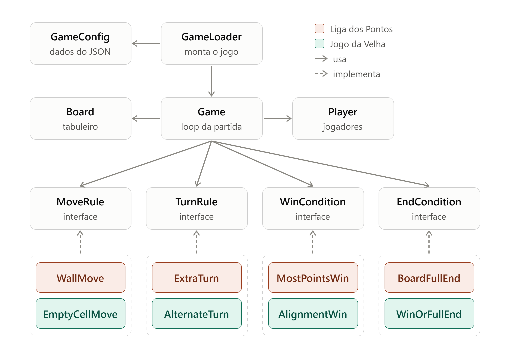

# Checkpoint 2

## O que muda entre os dois jogos

| Item | Liga dos Pontos | Jogo da Velha |
|---|---|---|
| Jogada | linha, coluna e lado da parede | linha e coluna |
| Efeito da jogada | coloca uma parede | coloca uma peça na célula |
| Turno | repete se fechar caixinha | sempre alterna |
| Vitória | mais pontos com o tabuleiro cheio | alinhar N peças (3 por padrão) |
| Empate | pontos iguais | tabuleiro cheio sem alinhamento |
| Fim de jogo | tabuleiro cheio | alguém vence ou tabuleiro cheio |
| Pontuação | usada | não usada |
| Peça do jogador | marca a caixinha | X ou O |


## Lista de abstrações da engine

| Interface | Pergunta que responde | Liga dos Pontos | Jogo da Velha |
|---|---|---|---|
| `MoveRule` | a jogada é válida? o que ela faz no tabuleiro? | parede em um lado da célula | peça numa célula vazia |
| `TurnRule` | quem joga depois? | repete se pontuou | sempre alterna |
| `WinCondition` | quem venceu? | mais pontos | alinhar N peças |
| `EndCondition` | a partida acabou? | tabuleiro cheio | alguém venceu **ou** tabuleiro cheio |

### Duas observações:

- Para o TurnRule funcionar, a jogada precisa devolver uma informação como “pontuou ou não”. Hoje o GameManager descobre isso comparando os pontos antes e depois, o que é específico do Liga dos Pontos.
- A EndCondition do Jogo da Velha pode usar uma WinCondition dentro dela, o que é composição, um dos conceitos que o PDF pede.

## O que é configurável em cada jogo

**Dois tipos de coisa:**

- Parâmetros: linhas, colunas, quantidade de jogadores, símbolos, quantidade de peças para alinhar.
- Escolha de regra: qual MoveRule, qual TurnRule, qual WinCondition, qual EndCondition.

## Formato json


```json
{
  "game": "Jogo da Velha",
  "board": { "rows": 3, "columns": 3 },
  "players": { "count": 2, "symbols": ["X", "O"] },
  "rules": {
    "placement": "EMPTY_POSITION",
    "turn": "ALTERNATE",
    "winCondition": { "type": "ALIGNMENT", "quantity": 3 },
    "endCondition": "WIN_OR_BOARD_FULL"
  }
}
```
```json
{
  "game": "Liga dos Pontos",
  "board": { "rows": 3, "columns": 3 },
  "players": { "count": 2, "symbols": ["A", "B"] },
  "rules": {
    "placement": "WALL_ON_CELL_SIDE",
    "turn": "EXTRA_TURN_ON_SCORE",
    "winCondition": { "type": "MOST_POINTS" },
    "endCondition": "BOARD_FULL"
  }
}
```

## Diagrama de classes

